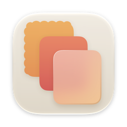
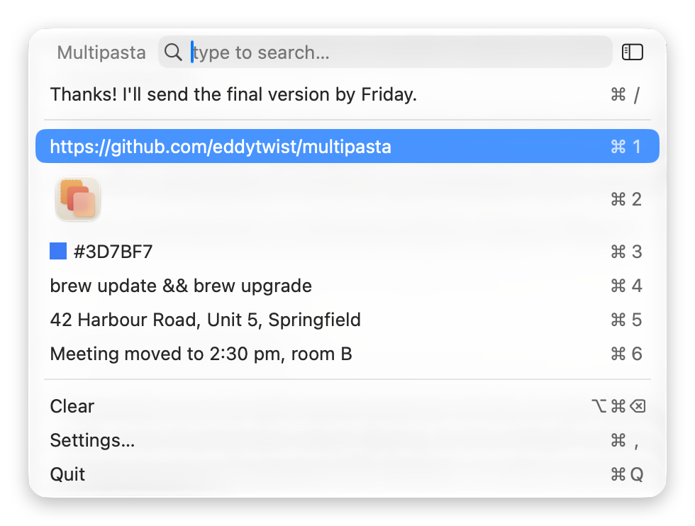
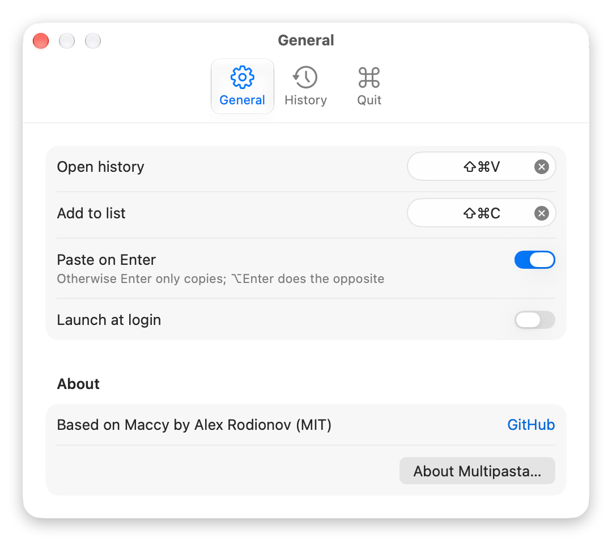
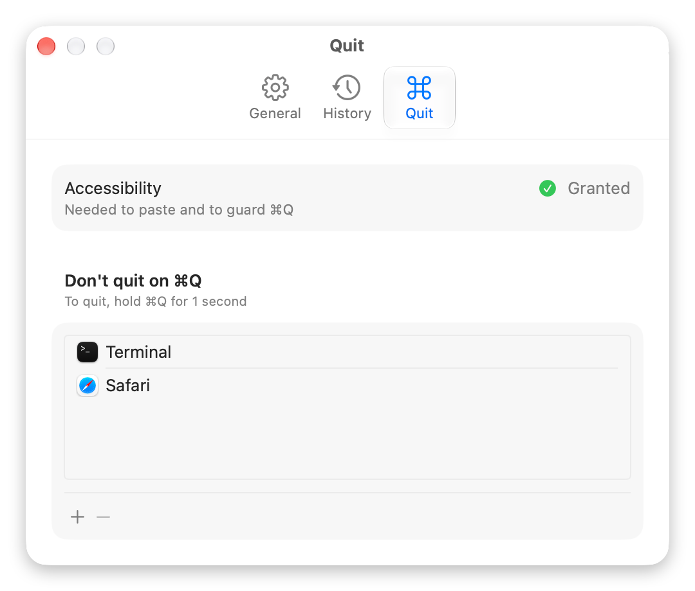

<div align="center">



<h1>Multipasta</h1>

<p><b>A clipboard history in your menu bar that also stops ⌘Q from quitting the wrong app.</b></p>

<p>Press ⇧⌘V, find anything you copied and paste it into the app you're in.<br>
Free and open source, for macOS 14 Sonoma or later. No network connections at all.</p>

<p>
  <a href="https://github.com/eddytwist/multipasta/releases/latest/download/Multipasta.dmg"></a>
</p>

<p>
  
  <a href="https://github.com/eddytwist/multipasta/releases/latest"></a>
  <a href="LICENSE"></a>
</p>

<!--
  Screenshots (English UI, docs/screenshots/):
  - popup-light.png / popup-dark.png: the history popup opened with ⇧⌘V over an app, a few text items, an image item,
    one pinned item, the search field at the top; light and dark appearance.
  - settings-light.png / settings-dark.png: the Settings window, General tab (Open history shortcut, Paste on Enter,
    Launch at login); light and dark appearance.
  - quit-settings-light.png / quit-settings-dark.png: the Settings window, Quit tab, with Terminal and Safari in the
    list. (The HUD itself can't be shown from a UI test: it needs ⌘Q held in a real guarded app.)
  Made by MaccyUITests/ReadmeScreenshotTests.swift (sample data, in-memory history), run with
  TEST_RUNNER_MULTIPASTA_README_SHOTS=1; window corners and shadow added afterwards.
-->

<picture>
  <source media="(prefers-color-scheme: dark)" srcset="docs/screenshots/popup-dark.png">
  <source media="(prefers-color-scheme: light)" srcset="docs/screenshots/popup-light.png">
  
</picture>

</div>

## Features

- **Clipboard history.** Text, images and files, 500 items by default (100 to 999). Pinned items stay at the top or
  bottom and survive clearing.
- **Paste where you are.** Press ⇧⌘V, type to search, press Return: the item is pasted into the front app. ⌥Return
  only copies it, ⌥⇧Return pastes it without formatting.
- **Preview.** Images, files and text too long for its row open in a preview panel next to the list.
- **List copy.** ⇧⌘C adds the selected text to a list, one line per copy; ⌘V pastes the whole list. The list is one
  item in the history, tagged LIST, and the format (plain lines, bullets or numbers) is in Settings → Advanced.
- **⌘Q guard.** In the apps you choose, ⌘Q quits only if you hold it for 1 second; a ring shows the progress. A quick
  ⌘Q by mistake does nothing.
- **Ignore what shouldn't be saved.** Skip whole apps, pasteboard types or text that matches a regular expression.
  Copies that password managers mark as concealed are never saved.
- **Bring your Maccy history.** If Maccy is installed, Multipasta offers to import its history and pins once; Maccy's
  own history stays unchanged.
- **Private.** History stays on your Mac. No accounts, no analytics, no update checks.

<table>
  <tr>
    <td width="60%" align="center">
      <picture>
        <source media="(prefers-color-scheme: dark)" srcset="docs/screenshots/settings-dark.png">
        
      </picture>
      <p><sub>Three short tabs; the rest is under Advanced</sub></p>
    </td>
    <td width="40%" align="center">
      <picture>
        <source media="(prefers-color-scheme: dark)" srcset="docs/screenshots/quit-settings-dark.png">
        
      </picture>
      <p><sub>Pick the apps where ⌘Q must be held for 1 second</sub></p>
    </td>
  </tr>
</table>

## Install

1. [Download **Multipasta.dmg**](https://github.com/eddytwist/multipasta/releases/latest/download/Multipasta.dmg),
   open it and drag **Multipasta** to Applications.
2. Open Multipasta. macOS says it can't verify the app: close the message (don't move the app to the Trash).
3. Open **System Settings → Privacy & Security**, scroll down and click **Open Anyway**. You do this once.
4. Press ⇧⌘V, click **Settings…** → **Quit** → **Open System Settings** and turn on Multipasta under
   **Accessibility**. Pasting, list copy and the ⌘Q guard need it.

Step 3 is there because the app isn't notarized by Apple: I don't have a paid Apple Developer account. Releases are
signed with the same certificate every time, so updates keep the Accessibility permission.

**If Return or ⌘1 doesn't paste**, macOS doesn't trust this copy of the app yet, even if the switch looks on. Open
**System Settings → Privacy & Security → Accessibility**, select Multipasta, click **−**, then **+**, choose
**Applications → Multipasta** and turn it on. Quit Multipasta from its popup and open it again.

**Requirements:** macOS 14 Sonoma or later, Apple Silicon or Intel. App in English and Russian.

## FAQ

<details>
<summary><b>How is it different from <a href="https://github.com/p0deje/Maccy">Maccy</a>?</b></summary>

Multipasta is a fork of Maccy, so the history, search, pins and pasting are Maccy's work. On top of that it has a
simpler Settings window (three tabs, the rest under Advanced), the ⌘Q guard, a one-time import of Maccy's history, and
its own icon and design.

Maccy is a great app and is actively maintained. If you don't need these extras, use Maccy.

</details>

<details>
<summary><b>Why does it need Accessibility?</b></summary>

To paste, Multipasta presses ⌘V for you in the front app, and macOS allows that only to apps with Accessibility. To add
to a list, it presses ⌘C the same way. The ⌘Q guard needs it too: it watches for ⌘Q while one of your guarded apps is in front. Without it, Multipasta still
keeps the history and copies items, but can't paste, add to a list or guard ⌘Q.

</details>

<details>
<summary><b>Why isn't it sandboxed? Does it go online?</b></summary>

The ⌘Q guard has to see and hold back a key press meant for another app, which a sandboxed app can't do. Multipasta
watches the keyboard only while your ⌘Q list isn't empty, acts only on ⌘Q in the apps on that list, and doesn't record
or store key presses.

It never goes online: no update checks, no analytics, no crash reports. To hear about new versions, watch the
repository's releases on GitHub.

</details>

<details>
<summary><b>Where is my history stored?</b></summary>

In `~/Library/Application Support/Multipasta/`, and the settings in `~/Library/Preferences/com.eddytwist.Multipasta.plist`.
To start over, quit Multipasta and delete both.

</details>

<details>
<summary><b>How do I keep passwords out of the history?</b></summary>

Most password managers mark what they copy as concealed or transient, and Multipasta, like Maccy, never saves those.
It also skips 1Password and KeeWeb types by default. For an app that doesn't mark its copies, add it in **Settings →
History → Don't save from these apps**. **Advanced…** also has ignored pasteboard types and regular expressions.
List copy follows the same rules: what the history wouldn't save isn't added to a list either.

</details>

<details>
<summary><b>When does a new list start?</b></summary>

Press ⇧⌘C in any app and the selected text becomes the next line of the list; the whole list is on the clipboard, so
⌘V pastes it. Once you paste it, with ⌘V or from the history, the next ⇧⌘C starts a new list. So does a ⇧⌘C more than
15 minutes after the last one (change the time or turn it off in **Settings → History → Advanced… → Lists**), after
you pin the list, delete it or clear the history. The message after each ⇧⌘C shows the line number, and 1 means a new
list.

Multipasta learns about the paste when an app asks the clipboard for the list's text. Apps that read the clipboard
themselves, such as other clipboard managers, ask for it too, so they may end a list early. For the same reason a list
stays on this Mac: Universal Clipboard doesn't pass it to your iPhone or iPad.

⇧⌘C is a shortcut in some apps (Chrome's developer tools, Finder); while Multipasta has it, they don't get it. Pick
another one in Settings → General if you need theirs.

</details>

<details>
<summary><b>The ⌘Q guard doesn't work in some app</b></summary>

When Secure Keyboard Entry is on (Terminal and some password fields turn it on), macOS hides key presses from other
apps, so ⌘Q isn't guarded until it's off. The Quit tab says when this happens.

</details>

<details>
<summary><b>Keyboard shortcuts</b></summary>

| Shortcut | Action |
|---|---|
| <kbd>⇧</kbd> <kbd>⌘</kbd> <kbd>V</kbd> | Open the history (change it in Settings → General) |
| <kbd>⇧</kbd> <kbd>⌘</kbd> <kbd>C</kbd> | Add the selected text to the list (anywhere; change it in Settings → General) |
| Type | Search |
| <kbd>↑</kbd> <kbd>↓</kbd> | Move the selection |
| <kbd>Return</kbd> | Paste into the front app (or only copy, with Paste on Enter off) |
| <kbd>⌥</kbd> <kbd>Return</kbd> | Only copy (or paste, with Paste on Enter off) |
| <kbd>⌥</kbd> <kbd>⇧</kbd> <kbd>Return</kbd> | Paste without formatting |
| <kbd>⌘</kbd> <kbd>1</kbd> … <kbd>⌘</kbd> <kbd>9</kbd> | Pick one of the first nine items; pinned items get a letter |
| <kbd>⌥</kbd> <kbd>P</kbd> | Pin or unpin |
| <kbd>⌥</kbd> <kbd>⌫</kbd> | Delete the item |
| <kbd>⌃</kbd> <kbd>Space</kbd> | Show or hide the preview |
| <kbd>⌥</kbd> <kbd>⌘</kbd> <kbd>⌫</kbd> | Clear the history (pins stay; add <kbd>⇧</kbd> to clear everything) |
| <kbd>⌘</kbd> <kbd>,</kbd> | Settings |
| <kbd>Esc</kbd> | Close |
| Hold <kbd>⌘</kbd> <kbd>Q</kbd> | Quit an app on your ⌘Q list |

Pin, delete and preview shortcuts can be changed in **Settings → History → Advanced… → Shortcuts**.
If your shortcut doesn't work in password fields, see
[Keyboard shortcut not working in password fields](docs/keyboard-shortcut-password-fields.md).

</details>

<details>
<summary><b>How do I uninstall it?</b></summary>

Turn off **Launch at login**, quit Multipasta and move it to the Trash. Delete the history and settings listed above
if you don't plan to come back, and remove Multipasta from **Privacy & Security → Accessibility**.

</details>

## Build from source

You need Xcode 26 or later.

```bash
git clone https://github.com/eddytwist/multipasta.git && cd multipasta && scripts/build-dmg.sh
```

It builds a universal Release app, signs it ad-hoc (or with `SIGN_IDENTITY="Developer ID Application: …"`) and makes
`build/Multipasta.dmg`. For development, open `Maccy.xcodeproj` and run the `Maccy` scheme; the project and folders
keep Maccy's names to make merging upstream changes easier.

## Credits & license

[MIT](LICENSE). Multipasta is based on [Maccy](https://github.com/p0deje/Maccy) © Alex Rodionov, also MIT; his
copyright notice is kept in [LICENSE](LICENSE). Changes © 2026 Eduard Ivanov · [eddytwist.com](https://eddytwist.com)
